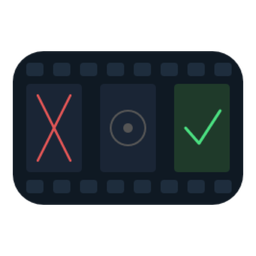

<p align="center">
  
</p>

<h1 align="center">ShotList</h1>

<p align="center">
  <b>Cull, develop, caption and sequence your street photos into a print-ready zine — in one desktop app.</b><br>
  Keyboard-first · RAW support · AI optional · no account, no telemetry, no subscription
</p>

<p align="center">
  <a href="https://github.com/2790karthikbhat/ShotList/releases/latest"><b>Download for macOS · Windows · Linux</b></a>
</p>

<!-- DEMO GIF: record cull → develop → zine and save as docs/demo.gif, then uncomment:
<p align="center"></p>
-->

## Install

**macOS or Linux, one command** (downloads the latest release; on macOS it also clears the unsigned-app warning):

```bash
curl -fsSL https://raw.githubusercontent.com/2790karthikbhat/ShotList/main/scripts/install.sh | bash
```

Or grab the file for your system from the [latest release](https://github.com/2790karthikbhat/ShotList/releases/latest):

| System                | File                                    |
| --------------------- | --------------------------------------- |
| macOS (Apple + Intel) | `ShotList_<version>_universal.dmg`      |
| Windows               | `ShotList_<version>_x64_en-US.msi` or `…_x64-setup.exe` |
| Linux                 | `ShotList_<version>_amd64.AppImage` or `.deb` |

The builds are **not code-signed yet**, so your OS will warn you the first time:

- **macOS** says the app "can't be opened" or is "damaged". Drag ShotList to Applications, then either
  right-click it → **Open** → **Open**, or run `xattr -dr com.apple.quarantine /Applications/ShotList.app` once.
  On macOS 15+, if there's no Open option, go to **System Settings → Privacy & Security** and click **Open Anyway**.
- **Windows** SmartScreen says "Windows protected your PC". Click **More info** → **Run anyway**.
- **Linux**: `chmod +x ShotList_*.AppImage && ./ShotList_*.AppImage`, or `sudo apt install ./ShotList_*.deb`.

## AI: bring your own key, or none at all

Culling, analysis, develop and zine layout all work fully offline. The AI features (auto-develop suggestions,
captions, zine sequencing) are optional. They use **your own** Anthropic API key, or a local model
through [LM Studio](https://lmstudio.ai) with no key and no cloud at all.

Your key is stored only on your machine, as plain text, in `shotlist/settings.json` inside the OS config folder
(`~/Library/Application Support/` on macOS, `~/.config/` on Linux, `%LOCALAPPDATA%` on Windows). It is never put in your photo folders.
It is sent only to the provider you picked, and only when you ask for an AI action. ShotList has no server,
no account and no analytics. Apart from those AI calls, the only network request is a one-time download of a
small open-source face-detection model from [onnx/models](https://github.com/onnx/models).

## Using an AI coding agent?

Point Claude Code, Codex, Cursor or a similar agent at this repo and ask it to set up ShotList.
[AGENTS.md](AGENTS.md) has non-interactive setup (`npm run setup`), a prerequisite checker that prints
fix commands (`npm run doctor`), a single "everything CI runs" command (`npm run check`), the code layout and
the conventions. [llms.txt](llms.txt) is a short machine-readable index of the docs.

---

> _From SD card to finished zine — with an AI that talks to you the whole way._

A keyboard-driven, AI-assisted photography pipeline for street and documentary photographers.
Built with Rust + Tauri 2.0 + React. Native performance, no subscription, no cloud lock-in.

---

## What It Does

ShotList is a full end-to-end creative pipeline in one desktop app:

```
Import RAW/JPEG → Cull → Technical Analysis → Develop → Caption → Zine PDF
```

Every AI action is **explained in plain language** — not a black box. When Claude suggests
a develop adjustment or writes a caption, it tells you _why_, in the voice of an experienced
darkroom collaborator.

---

## Features

### Cull

- Recursive folder scan — JPEG, PNG, TIFF, and camera RAW (CR2/CR3, NEF, ARW, RAF, RW2, ORF, DNG)
- RAW preview extraction via `rawler` — full EXIF orientation applied
- Keyboard-first workflow: one key per decision, auto-advance
- Filmstrip with shimmer skeletons, cull-state colour borders, face/group chips
- Off-thread thumbnail pipeline (rayon pool — never blocks the UI)
- Decisions persist to a per-folder `.shotlist.db` SQLite file; resumed automatically on re-import
- XMP sidecar read/write (compatible with Lightroom, Capture One, Affinity Photo)
- **Auto-cull** — signals computed per image (Laplacian focus score, face detection, pHash, exposure analysis); proposes picks/rejects in one click
- Export picks — copies selected images to a `Picks/` subfolder; originals never modified

### Analyse

- **RGB + Luminance histogram** — 256-bucket canvas, filled channel areas + white lum line
- **Ansel Adams Zone System** — 11-zone bar chart (Zone 0 = pure black → Zone X = pure white); Zone V %, Highlights %, Shadows % callouts
- **Spatial focus heatmap** — 8×5 Laplacian energy grid overlaid at correct image aspect ratio; red=soft, green=sharp
- **Colour temperature estimation** — R/B ratio from neutral mid-tone pixels; displayed as warm/cool gradient
- **Exposure stats** — mean luma bar, blown highlight %, crushed shadow %

### Develop

A 12-step non-destructive parametric pipeline applied in correct photographic order:

```
White Balance → Exposure → Highlights/Shadows → Whites/Blacks
→ Gamma-encode → Contrast → Clarity (unsharp mask) → Vibrance/Saturation (HSL)
→ Vignette → Grain → B&W channel mixer
```

- **Live preview** — debounced (180ms), applies to cached HD image or filmstrip thumb
- **Before / After toggle** — compare the original and developed image side by side
- **Accordion slider panels** — Basic, Presence, White Balance, Effects, B&W (with 6-channel luminance mixer)
- **Non-zero indicator** — amber dot on label + accent value display when a slider is off its default
- **Double-click to reset** individual sliders
- **Save** button appears in toolbar only when there are unsaved changes
- **Auto-develop with Claude** — streams suggestions one-by-one; each arrives as a card with param name, proposed value, and a short reason citing the actual technical data; Apply / Apply All buttons
- **Rotate & crop** — 90° left/right rotate, freeform or orientation-aware aspect-preset crop (1:1, 4:3, 3:2, 16:9, 4:1) with a draggable/resizable overlay; saved geometry propagates to Cull, Analyse, Caption, and Zine automatically, not just Develop's own preview

Parameters: `exposure` (±5 EV), `contrast`, `highlights`, `shadows`, `whites`, `blacks`, `clarity`, `vibrance`, `saturation`, `temperature`, `tint`, `vignette`, `grain`, `bwEnabled` + 6 B&W channel weights, plus non-destructive `rotation`/`crop` geometry.

### Caption

- **Generate with Claude** — Claude Vision analyses the image and outputs 5 fields as live NDJSON; each field pops into its form field the moment it completes
- **Title** — 5–10 words, newspaper-style headline
- **Description** — 2–3 sentences, journalistic present tense
- **Keywords** — interactive tag chips (Enter/comma to add, Backspace to delete last, click × to remove)
- **Location** — "City, Country" format
- **Credit** — photographer/agency name (user fills; Claude always leaves blank)
- **Save** — persists to SQLite; shows only when unsaved changes exist
- **Embed XMP** — writes all saved captions from the DB into `.xmp` sidecars in one shot; Lightroom/Capture One/Bridge reads `dc:title`, `dc:description`, `dc:subject`, `Iptc4xmpCore:Location`, `dc:creator`

### Zine Builder

- **Auto-seeded from picks** — opens pre-populated with all your culled picks so you trim and reorder rather than build from scratch
- **6 page templates** with visual SVG preview thumbnails in the inspector:
  - _Full Bleed_ — image fills page, caption overlay at bottom 15%
  - _Top 75%_ — image top three-quarters, caption panel below
  - _Left 50% / Right 50%_ — side-by-side image and text columns
  - _Grid 2×1_ — two images side by side
  - _Title Page_ — text-only, for cover or section breaks
- **4 paper sizes** — A4, A5, Square (200×200 mm), Half-Letter
- **Drag-to-reorder** horizontal page strip via `@dnd-kit`
- **Add / remove / swap images** — image picker modal shows all session thumbnails; hover a chip to reveal the × remove button; swap image via the inspector
- **Large page preview** — CSS mock renderer with prev/next navigation
- **Caption override** — per-page free-text that replaces the AI-generated caption in the PDF
- **AI Sequence** — Claude reads all captions and proposes a narrative page order, streamed in real-time with per-page reasoning
- **PDF export** — `printpdf 0.9.1` renders all pages at 300 DPI with letterbox-fit image placement; develop parameters (including rotate/crop) are applied before embedding; output saved to `<source_folder>/Zine/zine.pdf`

### App Shell & Navigation

- **Left nav rail** — icon-based stage switcher (Cull/Analyse/Develop/Caption/Zine) with an animated sliding active-indicator; collapsible to show stage names alongside the icons
- **Folder sidebar** — collapsible tree alongside the nav rail: Recents (removable), and a lazily-expanding Home/Desktop/Pictures tree that lists both subfolders and photos
- **Quick Look** — click any photo in the folder sidebar to preview it (RAW included) without importing its folder; "Open in Develop" imports the containing folder and jumps straight to that photo
- **Appearance** — Dark / Light / System theme, set in Settings; System mode follows macOS's appearance live while the app is open

---

## Architecture

A Rust + Tauri 2 backend (`src/`: IPC commands, domain logic, AI providers, SQLite) drives a React +
TypeScript frontend (`frontend/src/`). [AGENTS.md](AGENTS.md#layout) has the module-by-module layout.

### Database schema (6 migrations)

| Table            | Purpose                                                                           |
| ---------------- | --------------------------------------------------------------------------------- |
| `sessions`       | One row per imported folder                                                       |
| `images`         | One row per image — cull state, rating, EXIF; stable ID preserved across restarts |
| `ai_assessments` | Focus score, faces JSON, scene rank                                               |
| `develop_params` | Non-destructive develop JSON per image (incl. rotation/crop geometry)             |
| `captions`       | Title, description, keywords, location, credit per image                          |
| `zines`          | One zine per session — paper size                                                 |
| `zine_pages`     | Ordered pages — image reference, template, caption override, multi-image columns  |

---

## Build from source

Prerequisites:

- Rust 1.88+ (`rustup update stable`) and Node.js 18+
- macOS: Xcode Command Line Tools (`xcode-select --install`)
- Linux: `sudo apt-get install -y build-essential pkg-config libssl-dev libwebkit2gtk-4.1-dev libappindicator3-dev librsvg2-dev patchelf`
- Windows: MSVC build tools and WebView2 (see [Tauri prerequisites](https://v2.tauri.app/start/prerequisites/))
- Nothing else: SQLite, RAW decoding and face detection are bundled through Cargo (no `libraw`, `vcpkg` or system SQLite)

```bash
git clone https://github.com/2790karthikbhat/ShotList.git && cd ShotList
npm run setup    # checks prerequisites, installs deps, builds the frontend, compiles Rust (first run: several minutes)
npm run dev      # launch with hot reload
```

| Command          | What it does                                                         |
| ---------------- | -------------------------------------------------------------------- |
| `npm run doctor` | Check prerequisites only, printing the fix command for anything missing |
| `npm run dev`    | Run the app with hot reload (frontend + Rust rebuild on change)       |
| `npm run build`  | Release build plus installers in `target/release/bundle/`             |
| `npm run check`  | Everything CI runs: fmt, clippy, cargo test, ESLint, tsc, Vitest      |

---

## Setting Up AI Features

ShotList supports two AI providers: **Anthropic Claude** (cloud) and **LM Studio** (local, private).
Open the settings modal (gear icon in any stage's toolbar) and select your provider. The same
modal's **Appearance** section controls Dark/Light/System theme.

### Anthropic Claude

1. Get a key at [console.anthropic.com](https://console.anthropic.com)
2. Select **Anthropic Claude** in Settings → paste your key → Save

### LM Studio (local models, no API costs)

1. Download and run [LM Studio](https://lmstudio.ai) — start its local server (default `http://localhost:1234`)
2. Load a model:
   - **Caption + Auto-develop**: needs a multimodal vision model (e.g. LLaVA-1.5, Moondream2, Phi-3 Vision)
   - **AI Sequence**: any text model works (Llama 3, Mistral, Qwen, etc.)
3. In ShotList Settings: select **LM Studio**, enter the server URL and the exact model name as shown in LM Studio → click **Test connection** → Save

Your keys and model settings are stored locally in the app config directory. Nothing is sent anywhere except the API call you initiate.

### AI features

| Feature            | Anthropic     | LM Studio             |
| ------------------ | ------------- | --------------------- |
| Auto-cull          | no API needed | no API needed         |
| Auto-develop       | ✅            | ✅ (multimodal model) |
| Generate caption   | ✅            | ✅ (multimodal model) |
| AI Sequence        | ✅            | ✅ (any text model)   |

---

## Keyboard Shortcuts

### Cull Stage

| Key         | Action                  |
| ----------- | ----------------------- |
| `P`         | Pick (+ auto-advance)   |
| `X`         | Reject (+ auto-advance) |
| `U`         | Clear / Unreviewed      |
| `6`         | Flag (+ auto-advance)   |
| `1` – `5`   | Star rating             |
| `0`         | Clear rating            |
| `→` / `L`   | Next image              |
| `←` / `J`   | Previous image          |
| `Del` / `⌫` | Reject + advance        |

### Analyse / Develop / Caption / Zine stages

| Key       | Action         |
| --------- | -------------- |
| `→` / `L` | Next image     |
| `←` / `J` | Previous image |

### Develop stage

| Control                   | Action                             |
| ------------------------- | ---------------------------------- |
| Double-click slider label | Reset that slider to its default   |
| Before/After buttons      | Toggle original vs. developed view |
| Save (toolbar)            | Persist current params to DB       |

### Zine stage

| Control                  | Action                         |
| ------------------------ | ------------------------------ |
| Drag page chip           | Reorder pages                  |
| Hover page chip          | Reveal × remove button         |
| Click preview arrows     | Navigate between pages         |
| Click template thumbnail | Apply layout to current page   |
| Hover inspector image    | Reveal Change / Remove buttons |

---

## Roadmap

### Next

- Full RAW demosaicing for develop export (currently uses embedded preview)
- GPU acceleration for tone mapping on large files (wgpu compute shaders)
- Live folder watching for tethered shooting
- Multi-folder / multi-session support
- Print-on-demand upload (Newspaper Club, Blurb, Artifact Uprising)
- Bleed marks and crop guides for print-shop PDF output

---

## License

[MIT](LICENSE) © Karthik Bhat. Free to use, modify, and sell commercially.
AI API usage costs are billed to you through your own provider key.
